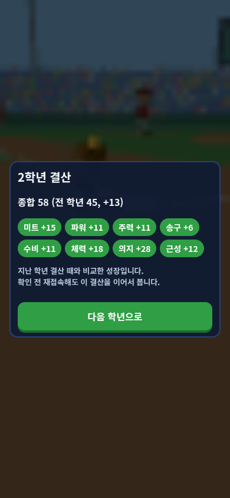
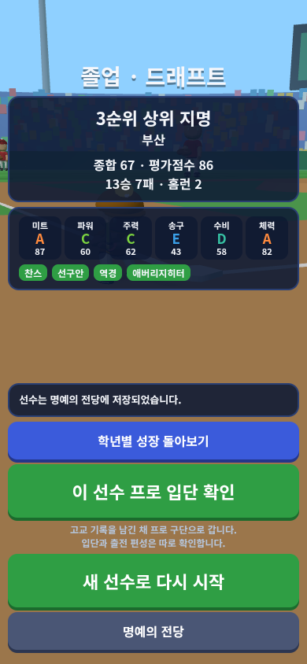
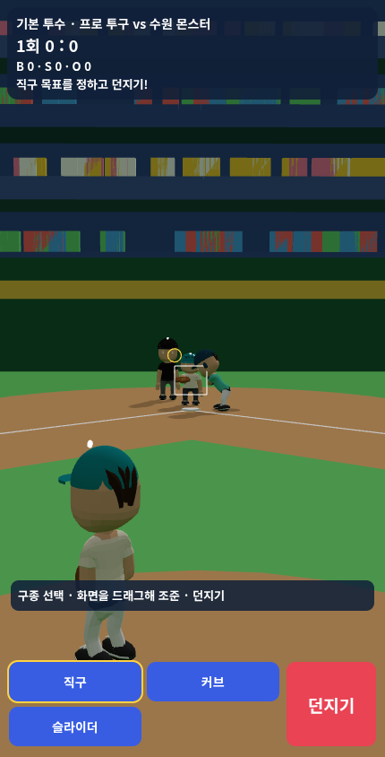
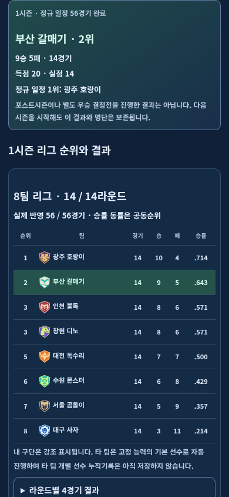

# 루키나인

고교 선수의 성장부터 졸업, 프로 입단과 구단 시즌까지 이어지는 세로 화면 3D 야구 게임입니다.

**[게임 실행하기](https://sigco3111.github.io/rookie-nine/)**

현재는 1차 사용자 검토용 개발판입니다. 아래 기능은 연결되어 있지만, 최종 마무리는 사용자 확인 후 결정합니다.

## 플레이 흐름

1. 타자 또는 투수를 만들고 훈련·휴식·공부·이벤트를 선택합니다.
2. 고교 3년, 144주 동안 성장하며 경기를 직접 플레이하거나 자동 진행합니다.
3. 학년별 성장과 졸업 지명 결과를 확인합니다. 졸업 선수는 명예의 전당에 남습니다.
4. 프로 구단을 선택하고 졸업 선수의 입단을 별도로 확인합니다. 입단만으로 자동 출전하지는 않습니다.
5. 명단 편성에서 타순과 선발을 저장한 뒤 직접 또는 자동 경기를 진행합니다.
6. 정규 시즌 결산과 과거 기록을 보고 같은 구단으로 다음 시즌을 시작할 수 있습니다.

새 고교 선수를 만들 때 명예의 전당 선배의 가르침을 계승할 수도 있습니다. 이것은 새 회차 육성이며, 입단한 프로 선수의 능력을 다시 키우는 기능과는 다릅니다.

## 조작

| 상황 | 조작 |
| --- | --- |
| 주간 육성 | 훈련·휴식 등 행동 버튼 선택. 컨디션과 학업도 관리합니다. |
| 직접 타격 | 화면을 드래그해 노란 조준 링을 맞추고 `SWING`을 누릅니다. 고교 타격은 원이 겹치는 타이밍 안내를 참고하세요. PC에서는 스페이스 키로도 스윙합니다. |
| 직접 투구 | 구종을 고르고 화면을 드래그해 목표를 정한 뒤 `던지기`를 누릅니다. 제구에 따라 실제 공은 목표에서 빗나갈 수 있습니다. |
| 자동 경기 | 고교 경기 선택 또는 프로 경기 화면의 자동 진행 버튼을 사용합니다. |
| 편성 위임 | 주요 능력 합 기준 제안을 확인해 편집에 적용합니다. 확정하려면 별도로 `편성 저장`을 눌러야 합니다. 최적 타순을 보장하는 기능은 아닙니다. |
| 소리 | 제목 화면, 고교 메뉴, 프로 메뉴의 소리 설정에서 효과음을 켜고 끄거나 시험할 수 있습니다. |

조준은 한 손가락을 따라갑니다. 취소된 터치가 남지 않도록 처리하며, 마우스는 화면 위 이동으로도 조준할 수 있습니다. 다른 앱이나 탭으로 이동할 때 효과음은 잠시 꺼지지만, **경기 일시정지 기능은 아닙니다.**

## 프로 리그

- 서울 곰돌이, 부산 갈매기, 광주 호랑이, 대구 사자, 대전 독수리, 인천 불독, 수원 몬스터, 창원 디노 중 운영 구단 하나를 선택합니다.
- 팀당 3이닝 14경기, 전체 정규 일정 56경기입니다.
- 내 구단 결과를 확정할 때 같은 라운드의 다른 세 경기 결과도 함께 저장합니다.
- 실제 반영된 결과로 순위를 계산하며 승률이 같으면 공동순위로 남깁니다.
- 졸업 선수의 고교 능력과 기록은 프로에 별도 사본으로 입단하며, 고교 원본을 바꾸지 않습니다.
- 개인 경기 성적과 구단 성적은 누적됩니다. 다음 시즌에도 명단과 과거 시즌 기록을 유지합니다.
- 상대 구단은 고정 생성 선수로 자동 진행합니다. 상대 선수별 장기 기록이나 육성은 저장하지 않습니다.

### 구현하지 않은 기능

계약기간·연봉·갱신 협상, 구단 간 이적, 포스트시즌, 프로 입단 후 훈련·경험치·능력 성장, 9이닝 전체 전술 조작은 없습니다. 정규 일정 1위는 별도 우승 결정전 결과가 아닙니다. 프로 선수는 경기를 통해 **성적**을 쌓지만 **능력치**는 입단 당시 값을 유지합니다.

## 저장과 재접속

- 기록은 현재 기기·브라우저의 저장 공간에 보관합니다. 계정 간 동기화나 다른 기기로의 자동 이동은 제공하지 않습니다.
- 같은 주소라도 다른 브라우저, 비공개 창, 사이트 데이터 삭제 후에는 기존 기록이 보이지 않을 수 있습니다. 기록을 지우기 전에 복구·내보내기 기능을 확인하세요.
- 저장 대기 또는 충돌 안내가 보이면 먼저 재시도·백업·복구 선택을 확인합니다. 저장 공간 오류가 해결되지 않은 상태에서 창을 닫으면 저장되지 않은 진행을 잃을 수 있습니다.
- 고교 직접 경기 중 창을 닫으면 그 경기의 시작 전부터 다시 선택합니다. 중단 전 투구·타석·점수는 복구하지 않으며, 그 주 훈련을 다시 적용하지 않습니다.
- 프로 직접 플레이 도중 창을 닫으면 마지막으로 완료되어 저장된 타석부터 이어갑니다. 진행 중이던 투구나 타석 자체를 복원하는 기능은 아닙니다.
- 이전 고교 성장·지명 규칙으로 시작한 선수와 이전 판정으로 준비된 프로 중간 경기는 그 규칙을 유지합니다. 새 규칙을 기존 선수나 졸업 기록에 소급 적용하지 않습니다.

## 현재 확인 범위와 남긴 한계

2026-11-20 배포판 기준으로 다음을 확인했습니다.

- 타자·투수 각각 정상 화면에서 144주 성장 → 같은 졸업 선수 입단·편성 → 프로 14경기·56결과 → 중간 재접속 → 다음 시즌·과거 결산 → 계승.
- 고교·프로의 타격·투구 네 경로에서 브라우저가 실제 화면 좌표로 생성하는 터치, 여러 손가락, 취소 후 재조준, 스윙·던지기 버튼.
- 화면 크기 변경 후 장면 시야 유지, 320~430px 세로 화면, 저장 실패·충돌·중복 반영 방지와 이전 기록 호환.
- 능력치 경계와 자동 경기 진행 한도, 경기 결과 합계와 재생 일치.

위 확인에는 자동 경기와 스크립트 입력이 포함됩니다. 모든 경기를 사람이 수동으로 플레이한 것은 아닙니다.

이번 마무리 범위에서는 실제 휴대폰의 프레임·발열·청음·OS 전환 검증을 제외했습니다. 세밀한 전략·특능 조합 균형과 추가 화면·연출·효과음 마감도 다음 업데이트로 미뤘습니다. 일부 전략이 더 유리하거나 직접·자동 경기의 효과가 다를 수 있습니다. 저장 손상·진행 막힘·조작 불가 문제까지 보류한다는 뜻은 아닙니다.

## 현재 배포 화면

2026-11-20 배포판에서 촬영했습니다. 학년 결산·졸업·리그 결과는 실제 정상 육성 및 시즌 진행 기록입니다. 프로 투구 화면은 입력 검사를 위해 시간을 느리게 한 장면으로, 실제 경기 속도를 보여주는 자료는 아닙니다.

| 고교 학년 결산 | 졸업과 프로 입단 연결 |
| --- | --- |
|  |  |

| 프로 직접 투구 | 정규 시즌 결과 |
| --- | --- |
|  |  |

## 로컬 실행

Node.js 20.19 이상인 20.x 버전 또는 22.12 이상과 npm이 필요합니다.

```bash
npm ci
npm run dev -- --host 127.0.0.1
```

터미널에 표시된 개발 서버 주소를 엽니다.

```bash
npm run build
npm run test:release
npm run test:touch
```

`build`는 `dist/`에 배포 파일을 생성합니다. 현재 GitHub Pages는 `docs/`를 사용하므로 빌드만으로 배포 내용이 바뀌지는 않습니다. 검사 스크립트는 Node.js 또는 Chrome이 필요한 항목을 포함하며, 브라우저 검사는 현재 Linux의 `/usr/bin/google-chrome` 경로를 사용합니다. 환경이 다르면 검사 스크립트의 실행 경로를 맞춰야 합니다.

## 리소스와 크레딧

사용 리소스의 출처와 이용 조건은 [CREDITS.md](CREDITS.md)를 확인하세요. 개별 리소스의 이용 조건이 이 저장소 전체의 라이선스를 뜻하지는 않습니다.
